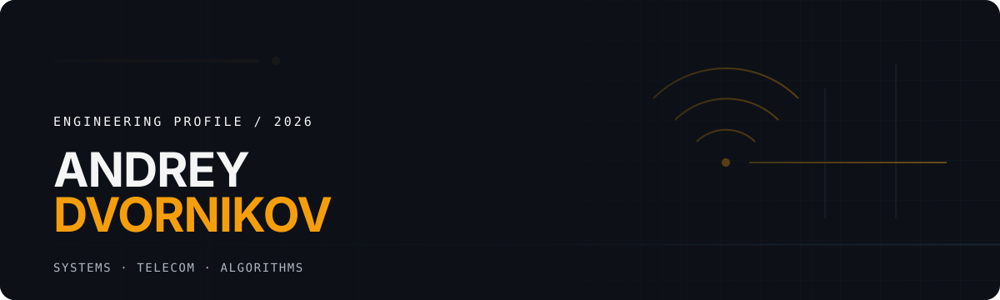

  

  

  Студент СибГУТИ, который исследует системы на стыке <strong>C++</strong>, <strong>телекоммуникаций</strong>, <strong>алгоритмов</strong> и <strong>сетей</strong>. 
  Мне интересно понимать, что происходит под капотом: от планирования радиоресурсов до измерений, профилирования и оптимизации.

  <a href="#проекты">Проекты</a>&nbsp;&nbsp;·&nbsp;&nbsp;
  <a href="#стек">Стек</a>&nbsp;&nbsp;·&nbsp;&nbsp;
  <a href="#связь">Связь</a>

---

### В фокусе

| | | |
|:--|:--|:--|
| **Telecom / RAN** LTE, MAC scheduling, multi-UE эксперименты, измерения throughput, latency и fairness. | **Systems / SDR** C++ и Linux-native разработка, программно-определяемое радио, TX/RX и анализ сигналов. | **Algorithms / Networks** Структуры данных, производительность, сетевые измерения и распределённые системы. |

 

### Проекты

#### [srsRAN 4G — research environment](https://github.com/AndreyDvornikov/srsRAN_4G)

Исследовательская среда на базе srsRAN для экспериментов с LTE RAN и MAC scheduler. Изучаю Round Robin, Proportional Fair и поведение нескольких UE через измеримые метрики: SINR/SNR, throughput, latency, spectral efficiency и Jain fairness index.

`LTE` · `RAN` · `C++` · `Python` · `ZMQ` · `Measure → Analyze → Optimize`

#### [SDR](https://github.com/AndreyDvornikov/SDR)

Практические эксперименты с ADALM-PLUTO и SoapySDR: передача, приём и анализ сигналов. C++17/CMake pipeline с отдельными TX/RX компонентами и Python-визуализацией.

`SDR` · `ADALM-PLUTO` · `SoapySDR` · `C++17` · `CMake`

#### [NetScan](https://github.com/AndreyDvornikov/NetScan)

Развивающийся графический инструмент для запуска, сбора и анализа сетевых измерений. В центре — iperf3, ping и traceroute; цель — вырастить проект в осмысленный инструмент диагностики сети.

`Python` · `Linux` · `Networking` · `Network measurements`

#### [Particle Probability Simulation](https://github.com/AndreyDvornikov/particle-probability-sim)

Учебно-исследовательская симуляция диффузии частиц в пористых структурах: random walk, распределение Максвелла, `D_eff`, tortuosity, RMS displacement и статистическая визуализация для нескольких геометрий.

`Python` · `NumPy` · `SciPy` · `Matplotlib` · `Tkinter`

#### [YADRO Traffic Model](https://github.com/AndreyDvornikov/YADRO_Traffic_Model) · [Hybrid Mesh Storage](https://github.com/AndreyDvornikov/Hybrid-Mesh-Storage)

Два экспериментальных направления: модель сетевого трафика с потоком **C++ → CSV → Python → анализ**, и исследование distributed storage / networking без громких обещаний раньше времени.

`C++` · `Python` · `Linux` · `Networking` · `Distributed systems`

---

### Стек

**Основной:** C++ · Python · Linux · CMake · Bash 
**Системы и сети:** LTE / RAN · SDR · TCP/IP · ZMQ · Docker · PostgreSQL · Redis 
**Инженерная практика:** algorithms · data structures · profiling · optimization · performance analysis 
**Изучаю и применяю:** Rust · Go · tmux · Arch Linux + Hyprland

---

### Образование

**СибГУТИ** · 09.03.01 «Информатика и вычислительная техника» 
Профиль: «Программное обеспечение систем мобильной связи» · 2024–2028

---

### Связь

Открыт к разговору об инженерных задачах, телекоммуникациях, сетях и алгоритмах.

<a href="https://github.com/AndreyDvornikov">github.com/AndreyDvornikov</a> &nbsp;·&nbsp; Авадик Кедаврик
